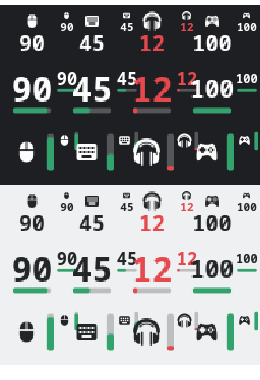

# Bluetooth Battery (Linux)

Shows the battery level of each connected Bluetooth device as its own icon in the
panel or system tray. It is a Linux take on
[Wireless-Device-Battery-Monitor](https://github.com/krisgfx9/Wireless-Device-Battery-Monitor),
built for KDE Plasma on CachyOS and Arch. It also works on any desktop with a
StatusNotifierItem tray.

- One tray icon per device, showing the device glyph and the percentage. The colour follows the level (green, then amber, then red).
- Three icon styles: **Device icon + percentage**, **Percentage only**, and **Device icon + level bar**.
- Matches light and dark panel themes automatically.
- Sends a desktop notification at low battery (5–40%, default 15%). It fires once and re-arms after the level rises 10 points above the threshold.
- Refreshes as soon as BlueZ signals a change, and also polls every 15 seconds to 5 minutes as a fallback.
- Right-click menu: show or hide each device, icon style, alert threshold, poll interval, refresh, start on login, quit.
- Battery history window: a chart of each device's level, how long each charge lasted, drain rate, and an estimate of time left (also shown in the icon's tooltip).
- `--list`, `--json` and `--history` print the current levels for scripts and bar widgets.



## Install

```bash
./install.sh            # installs to ~/.local/bin and starts it as a systemd user service
./install.sh uninstall
```

The app runs as the `btbattery` systemd user service. It starts with your desktop session,
restarts itself if it crashes, and keeps running when the terminal that installed it is
closed.

```bash
systemctl --user status btbattery     # is it running?
systemctl --user restart btbattery    # bring the icons back after choosing Quit
journalctl --user -u btbattery        # logs
```

The only requirement is `python-pyqt6`, which comes with KDE.

## How it works

The app reads `org.bluez.Battery1` for every connected device from BlueZ over the
system D-Bus, using the `ObjectManager.GetManagedObjects` call. It listens for
`PropertiesChanged` and `InterfacesAdded`/`InterfacesRemoved` signals. It needs no
vendor software and no root access.

## Headphones and earbuds don't show up?

With recent BlueZ (5.88 tested) and PipeWire, headset battery works with the default
settings. If an older system doesn't show your headset, try setting
`Experimental = true` in `/etc/bluetooth/main.conf`, restarting the `bluetooth`
service, and reconnecting the headset. Some headsets don't report battery to the
host at all.

## Battery history

Right-click any icon and choose **Battery history…**. The window shows:

- the current level, an estimate of time left, the drain rate, and how long a full charge lasts;
- a chart of the level over 24 hours, 7 days, 30 days or all time (green markers are charges, gaps are times the device wasn't connected);
- a list of past charges with how long each one lasted.

The app records a reading when the level changes, and at least once an hour while a
device is connected. Readings are kept for a year in `~/.local/share/btbattery/history.tsv`
(under 1 MB) and never leave your computer. A rise of 8 points or more counts as a
charge. Estimates appear once the level has dropped a few percent over at least 6 hours.
Right after a charge, the estimates use earlier charges until there's enough new data.
The app only records while it's running, so time the device spends off or disconnected
shows as a gap rather than a guess.

## Tips

- If KDE hides the icons under the tray's ^ arrow, open System Tray Settings → Entries and set the "btbattery" entries to **Always shown**.
- Settings are stored in `~/.config/btbattery/btbattery.conf`.

## Credits

This project was inspired by
[**Wireless-Device-Battery-Monitor** (BatteryHub)](https://github.com/krisgfx9/Wireless-Device-Battery-Monitor)
by [krisgfx9](https://github.com/krisgfx9), a Windows app that shows wireless-device
battery levels on the taskbar. This is an independent Linux implementation built on
BlueZ and D-Bus. It shares no code with the original, but the idea and the feature
design (per-device tray icons, low-battery alerts that re-arm, show/hide per device,
and `--list`/`--json` output) come from that project.

## License

GPL-3.0, the same license as the original project. See [LICENSE](LICENSE).
